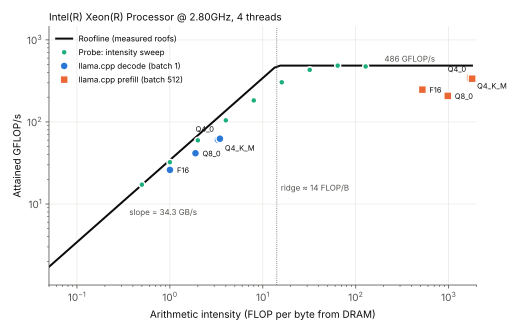
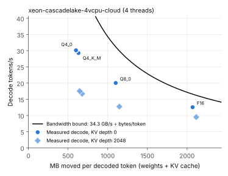
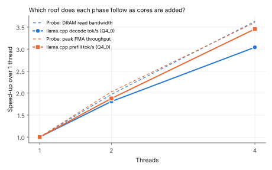

# cpu-inference-roofline

Where does transformer inference actually sit on a CPU's roofline?

This repo measures it. A small C probe measures the two roofs of the machine it runs on (sustained DRAM bandwidth and peak FMA throughput) and traces the curve between them. Then [llama.cpp](https://github.com/ggml-org/llama.cpp)'s `llama-bench` runs the same model in four weight formats, at several thread counts and KV-cache depths. Every token is costed in bytes moved and FLOPs done, using the model file's real tensor sizes, so each run becomes a point on the roofline rather than a bare tokens/s number.

The claim under test: **autoregressive decode at batch size 1 is memory-bandwidth-bound on CPUs, and quantization helps because it moves fewer bytes, not because it removes the bottleneck.**



## First results (one machine so far)

Intel Xeon (Cascade Lake, AVX-512 VNNI), 4 vCPUs on a cloud VM, 15 GiB. Model: TinyLlama-1.1B shapes (see [synthetic weights](#synthetic-weights)). llama.cpp `d7a695e`. Full table in [`results/SUMMARY.md`](results/SUMMARY.md), raw data in [`results/`](results/).

| Measured roof | Value |
|---|--:|
| DRAM read bandwidth (4 threads) | 34.3 GB/s |
| Peak fp32 FMA throughput (4 threads) | 486 GFLOP/s |
| Ridge point | 14 FLOP/byte |

| Format | MB moved / token | Decode tok/s | FLOP/byte | Bandwidth roof used | Compute roof used | Decode tok/s, KV depth 2048 |
|---|--:|--:|--:|--:|--:|--:|
| F16 | 2070 | 12.6 | 1.0 | 76% | 5% | 9.5 |
| Q8_0 | 1100 | 20.0 | 1.9 | 64% | 9% | 12.7 |
| Q4_K_M | 631 | 29.3 | 3.3 | 54% | 13% | 16.7 |
| Q4_0 | 600 | 30.1 | 3.5 | 53% | 13% | 17.5 |

What the numbers say:

1. **Decode lives on the bandwidth slope.** Every format decodes at 1 to 3.5 FLOP/byte, 4 to 14 times left of the ridge. Decode never uses more than 13% of the compute the cores can deliver. Prefill (batch 512) runs at hundreds of FLOP/byte and reaches 43% to 72% of the compute roof on the same cores. Same weights, same kernels, opposite bottleneck.
2. **Quantization buys bytes, and the speed-up falls short of the byte savings.** Q4_0 moves 3.45x fewer bytes per token than F16 but decodes only 2.4x faster. The share of the bandwidth roof drops from 76% to 53%. Once the DRAM traffic shrinks, something on the core side (dequantization, dot-product instruction throughput, per-layer thread synchronisation) starts to show. That residual is the part quantization does not fix, and it is exactly where a CPU-shaped dataflow would have to win.
3. **KV-cache depth costs far more than its bytes.** At 2048 tokens of context, Q4_0 decode moves 8% more bytes per token (600 MB to 646 MB) but slows down by 42% (30.1 to 17.5 tok/s). The bytes-only model cannot explain that. Attention over a growing cache behaves like a locality problem, not a bandwidth one, which makes cache-aware KV layout and eviction a concrete CPU question rather than a GPU one.
4. **Decode does not follow the cores the way bandwidth does.** From 1 to 4 threads, DRAM read bandwidth scales 3.6x and prefill scales 3.5x, but decode scales 3.0x. Per-token synchronisation across a small batch-1 workload eats part of each added core.





## What is measured, exactly

**Roofs** (`probe/roofline_probe.c`, portable C11 + OpenMP + vector extensions; x86 and Arm):

- *Bandwidth*: a read-only vector reduction over 256 MiB arrays (well above any L3), best of 5. This is the closest analogue to decode streaming weights. A STREAM-style triad is also reported.
- *Compute*: fp32 FMA with independent accumulators, plus the top of the intensity sweep; the higher of the two is the roof.
- *Intensity sweep*: stream the array from DRAM and do K FMAs per loaded vector for K = 1 to 256. These are the green points on the roofline plot: the roof measured, not taken from a datasheet.

**Per-token cost** (`harness/bench.py`), from the GGUF's real tensor sizes:

- *Decode bytes/token* = every weight tensor except the token-embedding table (a one-row gather per token, unless tied to the output head) + the K and V cache read at the average depth of the test (f16).
- *Prefill bytes/token* = the same, divided by the micro-batch (512), since the batch shares one pass over the weights.
- *FLOPs/token* = 2 x matmul parameters + 4 x layers x d_model x depth for attention.
- *Bandwidth/compute roof used* = (bytes or FLOPs per token) x tokens/s, divided by the probe's roof at the same thread count.

## Run it on your machine

Linux or macOS with a C compiler, CMake, Git and Python 3.9+:

```bash
git clone https://github.com/Victor-M16/cpu-inference-roofline
cd cpu-inference-roofline
./run.sh my-laptop-i5-8250u "2018 ThinkPad, on AC power"
```

This builds llama.cpp, generates the synthetic model in four formats (about 4.7 GB of disk, 2.5 GB of RAM for the F16 run), measures everything, and writes `results/<label>.json` plus the figures in `docs/`. Expect 20 to 40 minutes on a 4-core machine; the F16 runs at 1 thread are the slow part.

Options:

```bash
MODELS="path/a.gguf path/b.gguf" ./run.sh <label>   # real checkpoints instead of synthetic ones
SHAPE=llama-3.2-1b ./run.sh <label>                 # other shapes: llama-3.2-3b, llama-2-7b
python3 harness/bench.py --help                     # threads, depths, prompt/gen lengths
```

On macOS, `brew install cmake libomp` first. On Windows, use WSL2. Plug in to AC power, close other programs, and don't run anything else during the benchmark; a compile in the background halved the measured bandwidth roof on the first attempt here.

**Wanted: older CPUs.** The point of the comparison is the installed base, the machines that already sit in banks, schools and government offices. Results from pre-AVX2 and early AVX2 laptops (Sandy Bridge to Skylake), Arm SBCs (Raspberry Pi 4/5) and low-end Ryzen parts are the most useful. Open a pull request with your `results/*.json`.

## Synthetic weights

The model hub is unreachable from some networks, including the one this was first run on. `harness/make_synthetic_gguf.py` therefore writes a Llama-architecture GGUF with the exact tensor shapes of a published model and random weights. For dense transformers, inference speed depends on shapes and data types, not on weight values, so tokens/s and bytes/token match the real checkpoint (the Q4_K_M file generated here is 0.67 GB, the same as the published TinyLlama-1.1B Q4_K_M). The text it generates is meaningless. Use real GGUFs with `MODELS=...` whenever you can, and say which you used.

## Caveats

- One machine so far, and a virtual one. A KVM guest shares its host's memory controllers; the roofs were stable across 5 idle runs (32 to 36 GB/s), but treat single-VM numbers as provisional until bare-metal runs are in.
- The compute roof is fp32 FMA. Quantized prefill in llama.cpp uses int8 dot products (VNNI here), whose ceiling is higher, so the prefill "compute used" figures for Q8_0 and Q4 overstate how close they are to their real ceiling.
- FLOP counts ignore dequantization, softmax, norms and RoPE, and the KV-byte model assumes each cached K/V element is read once per token. Point 3 above is exactly where this model breaks down, which is the interesting part.
- The roofline locates the bottleneck; it does not explain the residual. Separating dequantization cost from synchronisation cost needs hardware counters (`perf stat` for stalled cycles and LLC misses, or VTune). That is the next step.

## Next

- `perf`-counter breakdown of the 47% bandwidth gap at Q4 (memory-stall vs. retiring vs. synchronisation cycles).
- Two or three more CPU generations, including an old one, on bare metal.
- Attention locality at depth: decode time against KV depth from 0 to 8k, with and without flash attention, against the cache sizes of each machine.
- From measurement to mechanism: CPU-specific KV layouts and eviction, and speculative decoding treated as the inference analogue of branch prediction.

## Why

I build onboarding and eKYC systems for a bank in Malawi. The models that read faded national IDs reliably need GPUs; the infrastructure they would run on has none and will not get any. This repo is the first measured step of a research question: what would transformer inference look like if the CPU were treated as a first-class target instead of a fallback for the GPU?

## License

MIT. llama.cpp is fetched at build time under its own MIT license.
